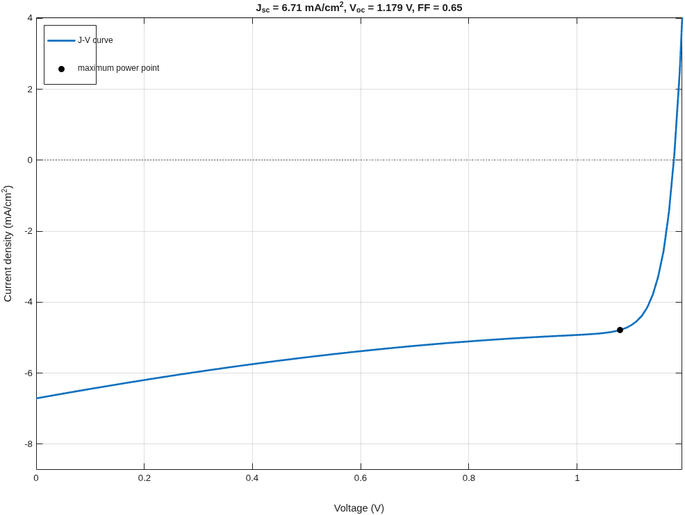
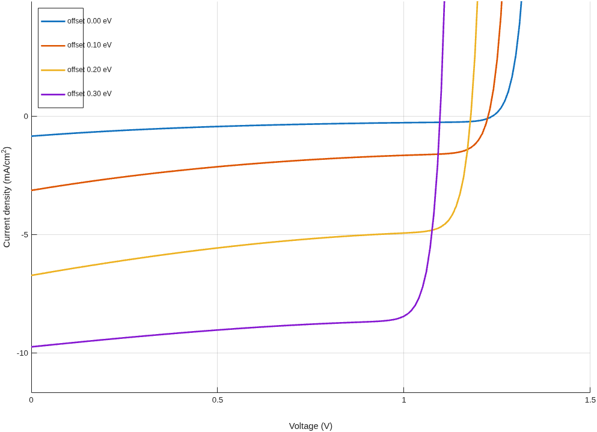
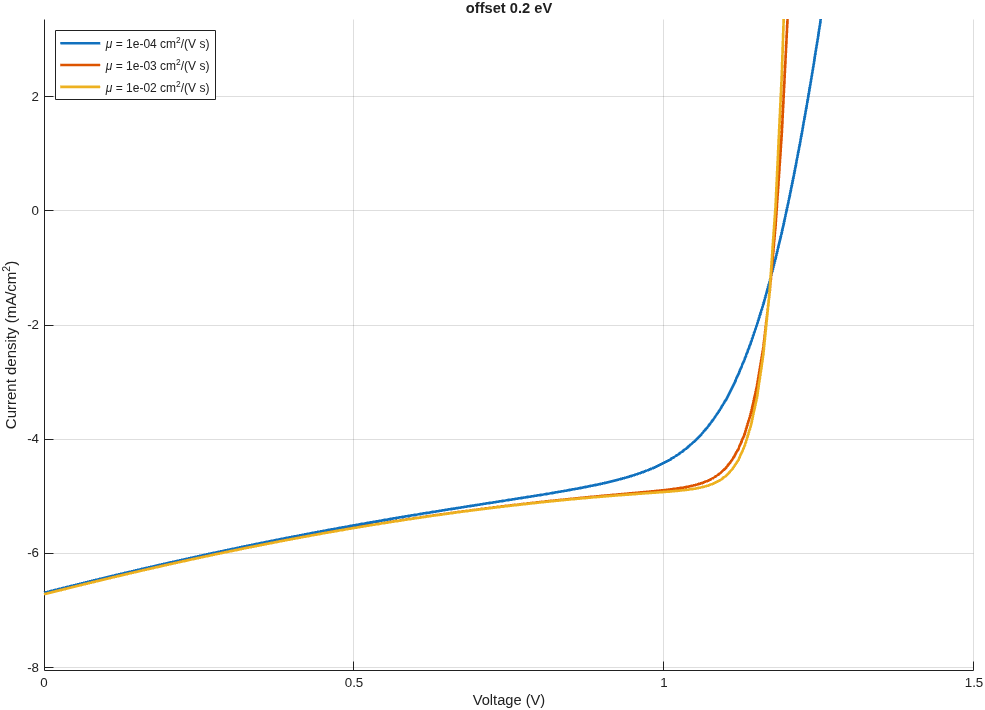
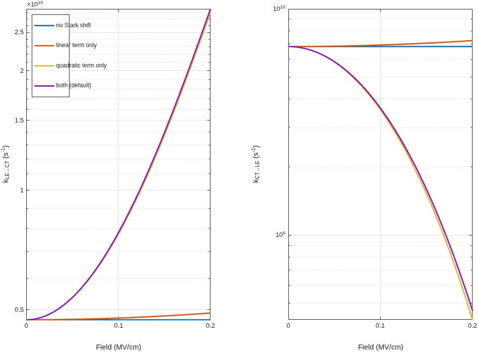
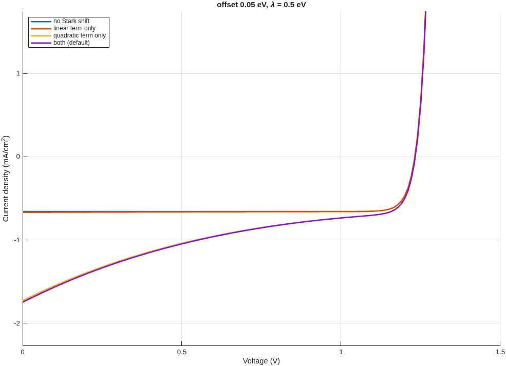
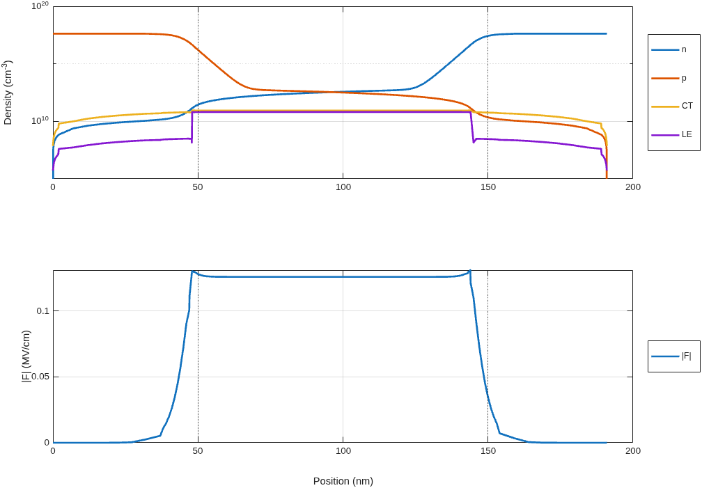
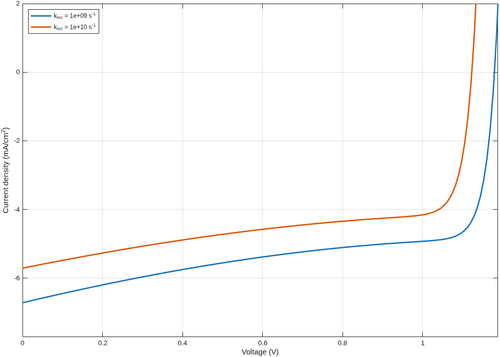
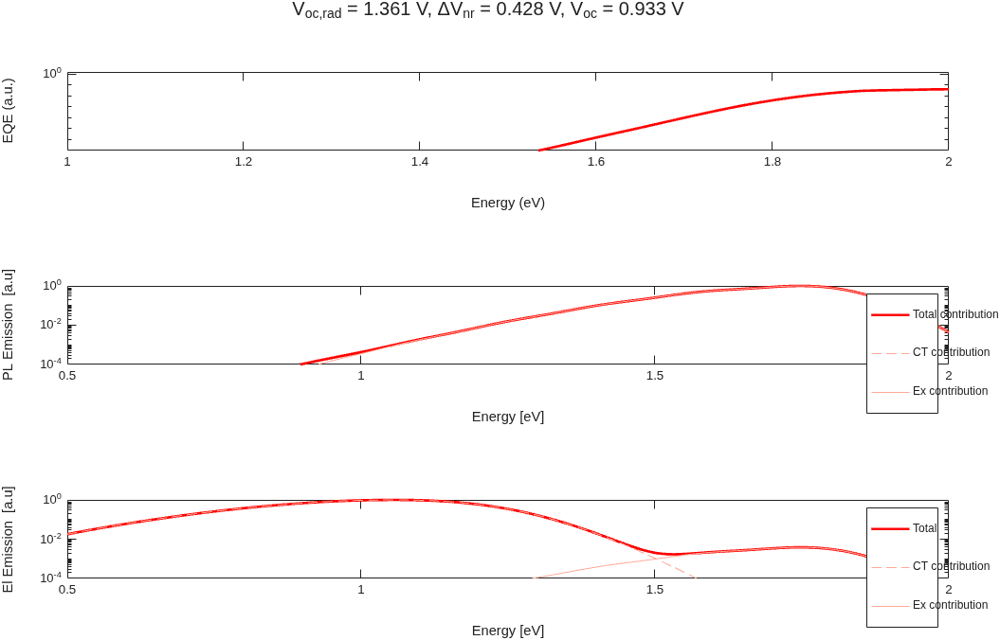
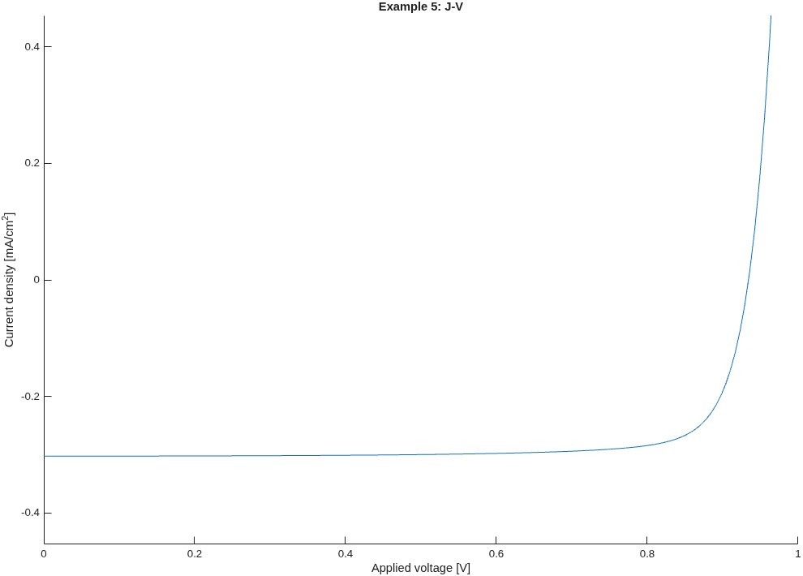
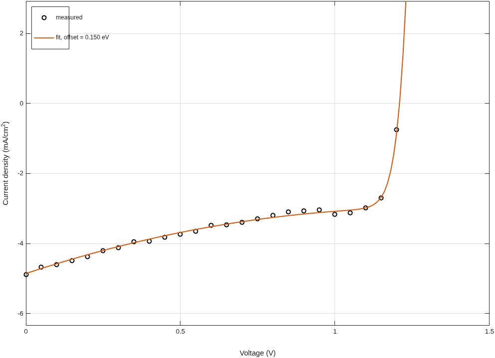

# Examples

A guided series for first-time users. Each script runs on its own: open it in MATLAB and press **Run**, or type its name at the command prompt from this folder. Every script adds the code folders to the path itself (`startup.m`), prints its key results and draws figures. Read the comments from top to bottom.

| Script | What it shows | Runtime |
|---|---|---|
| [`ex01_first_jv_curve.m`](ex01_first_jv_curve.m) | One J-V curve with `external_model`; Jsc, Voc, FF and PCE with `jv_parameters` | ~10 s |
| [`ex02_parameter_sweep.m`](ex02_parameter_sweep.m) | Sweeping a material parameter (LE–CT offset) and a device option (mobility) | ~1 min |
| [`ex03_stark_effect.m`](ex03_stark_effect.m) | Field-dependent LE↔CT rates and the linear/quadratic Stark controls (`RCT`, `'delta_alpha'`) | ~40 s |
| [`ex04_device_simulation.m`](ex04_device_simulation.m) | The steps behind `external_model`: device parameters, equilibrium, short circuit, J-V sweep; carrier and field profiles; editing a rate | ~30 s |
| [`ex05_recombination_and_spectra.m`](ex05_recombination_and_spectra.m) | States from optical parameters (`paramsRec`), radiative limits, PL/EL spectra, a device from a parameter file | ~20 s |
| [`ex06_fit_measured_jv.m`](ex06_fit_measured_jv.m) | Fitting a model parameter to a measured J-V curve | ~2 min |

## What you will see

Figures produced by the scripts with their default settings.

**Example 1**: J-V curve under 1 sun, with the maximum power point.

**Example 2**: a larger LE–CT offset raises Jsc but lowers Voc (left). At low mobility the knee softens and FF drops (right).

 

**Example 3**: field dependence of the LE→CT and CT→LE rates for each Stark term (left) and its effect on the J-V curve (right). The quadratic term carries most of the field dependence; in an isotropic film the linear term averages out to first order.

 

**Example 4**: carrier, CT and LE densities and the field across the device at short circuit (left; dotted lines are layer boundaries), and the effect of a 10× faster CT decay (right).

 

**Example 5**: absorption (EQE), PL and EL spectra computed from the LE and CT state parameters (left), and the J-V curve of that device (right).

 

**Example 6**: fit of the offset to a noisy J-V curve.

## Which route to use

- **`external_model(V, offset, lifetime_ex, lambda, RCT, E_gap, R_s, ...)`**: material parameters in, J(V) out. Best for parameter studies and fitting (examples 1–3, 6).
- **`build_MarcusTransfer_device` + `device`**: access to every device parameter, the full time- and position-resolved solutions, and other experiments (`runsolVoc`, `runsolTPV`, ...) (example 4).
- **`paramsRec` + `deviceparams`**: full control of the LE and CT states and of the device stack through a parameter file in `parameters/` (example 5).

## Conventions

- Current density J in mA/cm², negative where the cell delivers power; voltage in V; 1 sun = AM1.5G.
- Energies in eV, rates in s⁻¹, densities in cm⁻³, positions inside the solver in cm.
- The physics and all controls are described in [`docs/solver.md`](../docs/solver.md); the parameter file columns in [`docs/List_of_Parameters.docx`](../docs/List_of_Parameters.docx).

`tests/examplesTest.m` runs every example, so they are kept working with the code.
